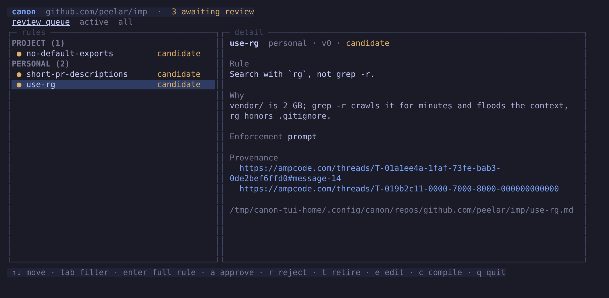

<p align="center"></p>

<h1 align="center">canon</h1>

<p align="center">Your coding-agent rules, as records you approve. Compiled for Amp, Claude Code, and Codex.</p>

---

Agents keep learning your conventions, and then forget them. canon gives each convention a record with a status, a why, and a link to where it came from. An agent can **propose** a rule; only you **approve** it. Approved rules are compiled into the files each agent already reads, and your personal rules never touch git.



> **Experimental.** The file formats and commands may change.

## Install

```sh
git clone https://github.com/peelar/canon && cd canon
bun install && bun link          # puts `canon` on PATH
```

## Use it

```sh
canon                            # review queue: approve, reject, retire, edit
canon list                       # rules in force for this repo
canon compile                    # write them into each agent's files
canon compile --check            # exit 1 when those files are stale
```

Agents use the `--json` commands through the bundled skill:

```sh
npx skills add peelar/canon --skill canon
```

## How it works

- **One rule, one file.** Markdown with TOML frontmatter: `id`, level (`personal`, `project`, `org`), status, version, optional path globs, provenance, and a `## Why` section.
- **A lifecycle.** `candidate` → `active` → `enforced`, or `rejected` / `retired`, each with a reason. Only active and enforced rules compile.
- **Shared rules** go into a managed block in your committed `AGENTS.md`. Your hand-written text stays as it is.
- **Personal rules** go only into files git ignores: `AGENTS.override.md` for Codex, `CLAUDE.local.md` for Claude Code, and a per-repo file under your home directory for Amp.
- **Conflicts fail the build.** Two active rules that contradict each other never reach the agent together.

| | Codex | Claude Code | Amp |
| --- | --- | --- | --- |
| Shared rules | `AGENTS.md` | `AGENTS.md` | `AGENTS.md` |
| Personal rules | `AGENTS.override.md` | `CLAUDE.local.md` (imports `AGENTS.md`) | home-directory file, loaded by glob |
| Session hook | – | `plugins/claude/settings.json` | `plugins/amp/canon.ts` |

More detail, including the Amp workaround and its caveats: [docs/how-it-works.md](docs/how-it-works.md).

## Develop

```sh
bun test                         # contract tests, in temp HOMEs and temp git repos
bunx tsc --noEmit
```
